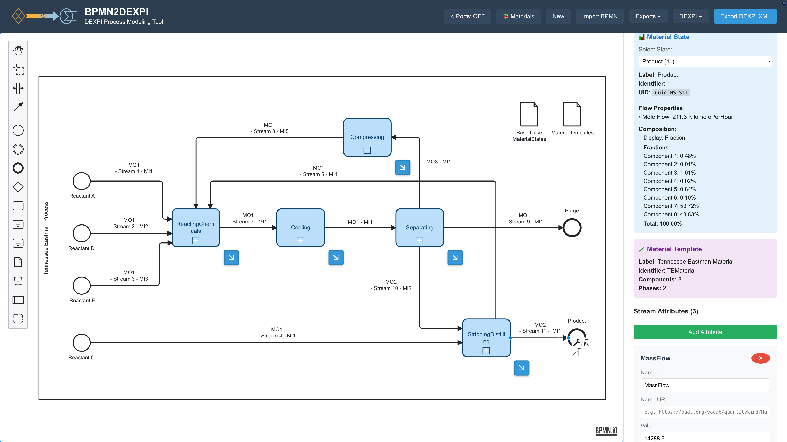

[](https://zenodo.org/badge/latestdoi/1142310809)

A web-based tool for modeling chemical processes in BPMN 2.0 and exporting to DEXPI 2.0–compliant block flow and process flow diagrams, validated against the official DEXPI XML Schema.

**Use it in your browser — no installation:** [skhella.github.io/bpmn2dexpi](https://skhella.github.io/bpmn2dexpi/). Everything runs client-side; diagrams are autosaved locally and never leave your machine. A first-visit guide and an interactive step-by-step tour walk through modeling a BFD/PFD with DEXPI semantics, and the Tennessee Eastman example loads with one click.

## Features

- **Visual modeling** — drag-and-drop BPMN 2.0 editor with a DEXPI-aware palette
- **DEXPI 2.0 export** — XSD-validated output, with a structural fallback in browser contexts
- **DEXPI 2.0 import** — open an existing DEXPI Process file as an editable BPMN diagram with automatic layout; content round-trips completely (see below)
- **Strict-mode fidelity check** — five-dimensional validation against the DEXPI 2.0 information model: property names and kinds, data types, reference targets, cardinality, and class existence
- **Profile-based extensibility** — declare custom classes or property extensions in a Profile XML, or auto-generate a Profile from any model to close vocabulary gaps
- **Material library** — materials, compositions, and thermodynamic states
- **Typed ports & streams** — Material / Energy / Information, with flow rates, compositions, and qualified parameters
- **Instrumentation variables on ProcessStep** — measured / controlled variables author canonically on the connected ProcessStep (DEXPI 2.0 spec p.900); a dedicated panel on connected `DataObject`s offers a property dropdown sourced from the connected step's class
- **CLI tool** — batch-convert BPMN to DEXPI 2.0 XML from the terminal or Python; validate existing DEXPI 2.0 files — Process (BFD/PFD) *and* Plant (P&ID) — with `--validate`
- **Neo4j export** — push the process graph to Neo4j: steps and instrumentation as nodes, typed flow relationships (material, thermal, electrical, mechanical energy), section hierarchy, port-level entry/exit links, material library with fractions, and every quantity as a property

## Prerequisites

- **Node.js** 20 LTS or newer (jsdom 29 requires Node 20+)
- **npm** 9+
- **xmllint** (for XSD validation in Node/CLI — `libxml2-utils` on Linux, `brew install libxml2` on macOS). Browser contexts use a structural fallback.

## Quick Start

The fastest way to try the tool is the hosted app: [skhella.github.io/bpmn2dexpi](https://skhella.github.io/bpmn2dexpi/) — no setup needed. To run it locally instead:

```bash
git clone https://github.com/skhella/bpmn2dexpi.git
cd bpmn2dexpi
npm install
npm run dev        # web app at http://localhost:5173
```

## CLI

```bash
npm run transform input.bpmn output.xml
# also writes output.profile.xml (imported by output.xml) when the model
# uses properties or classes beyond the DEXPI 2.0 vocabulary;
# --no-profile opts out

# validate an existing DEXPI 2.0 XML file (Process or Plant/P&ID, from any
# tool) — XSD + all five fidelity dimensions; load the Profiles it was
# written against via --profile
npm run transform -- --validate existing-dexpi.xml

# or install globally
npm install -g bpmn2dexpi
bpmn2dexpi input.bpmn output.xml
```

## Python

```python
from bpmn2dexpi import transform

transform('input.bpmn', 'output.xml')   # save to file
xml = transform('input.bpmn')           # get as string
```

See [CLI_USAGE.md](./CLI_USAGE.md) for more.

## Web Interface

Open the [hosted app](https://skhella.github.io/bpmn2dexpi/) (or `http://localhost:5173` when running locally), drag elements from the palette, connect with typed flows, configure ports and stream properties in the side panel, edit instrumentation variables on connected `DataObject`s, and export to DEXPI 2.0 XML or Neo4j.

The *Import ▾* menu takes a BPMN diagram, a DEXPI XML document, or a DEXPI Profile. *Import DEXPI XML* opens an existing DEXPI 2.0 Process document as an editable diagram: process steps, typed ports, streams, subprocesses, instrumentation wiring, stream quantities with their qualifiers, and the full material library (templates, components, states, compositions) are reconstructed, and an obstacle-aware layout engine places everything automatically — DEXPI Process carries no diagram geometry, so the layout is heuristic. Content survives the cycle completely: exporting the imported diagram reproduces the original document's information-model content object-for-object (an integration test pins this on the Tennessee Eastman benchmark; element order and per-run ids may differ).



## Architecture

The transformer is a standalone, framework-independent TypeScript module — usable independently of the React frontend:

```
src/transformer/
├── BpmnToDexpiTransformer.ts        # Core BPMN → DEXPI 2.0 transformation
├── DexpiToBpmnTransformer.ts        # DEXPI 2.0 → BPMN import (heuristic layout)
├── DexpiProcessClassRegistry.ts     # Loads the DEXPI schemas + any Profiles
├── DexpiOutputValidator.ts          # XSD validation + structural fallback
├── DexpiPropertyNameValidator.ts    # Strict-mode fidelity checks
├── DexpiDataTypeValidator.ts        #   (property names, data types,
├── DexpiReferenceValidator.ts       #    reference targets, cardinality,
├── DexpiCardinalityValidator.ts     #    class existence)
├── DexpiClassExistenceValidator.ts  #
├── DexpiProfileGenerator.ts         # Generates a Profile XML closing strict gaps
├── TransformerLogger.ts
├── types.ts
└── __tests__/

dexpi-schema-files/
├── DEXPI_XML_Schema.xsd             # Official DEXPI 2.0 XML Schema
├── Process.xml                      # DEXPI 2.0 Process model (BFD/PFD)
├── Plant.xml                        # DEXPI 2.0 Plant model (P&ID) — used by --validate
├── Core.xml                         # DEXPI 2.0 Core model (shared foundation)
└── DEXPI_XML_Schema_1.1.0_RC_1.xsd  # Draft schema 1.1.0 (reference only, not used)
```

## Validation

Every export is checked against the official DEXPI 2.0 XML Schema, so the file you get is always exchangeable with other DEXPI tools.

The export follows the Process model as declared, which matters to strict consumers: instrumentation activities sit under `ProcessModel.InstrumentationSystemActivities` and reference the step they observe (never inside `SubProcessSteps`, which admits process steps only); `Description` is written as `MultiLanguageString` wherever the model declares it so, and a step's `bpmn:documentation` becomes its `Description`; `MoleFlow` sits on `Composition`; and every step carries `HierarchyLevel` — `ProcessSection` for a step with sub-steps, `UnitOperation` otherwise, or an explicit level set on the element.

Turn on **Strict mode** (export dialog checkbox, `--strict` CLI flag, or `{ strict: true }` on `transformer.transform()`) for deeper fidelity checks: property names, data types, reference targets, required-property cardinality, and class existence. Strict mode never blocks the export — it produces a summary dialog (or CLI output) listing what doesn't match the schema, so you can fix it in the panel or capture it in a generated Profile.

The data-type check is tight: every enumeration reference — including each measurement's unit, carried in the canonical `PhysicalQuantity` shape — is resolved against the imported model, so a reference to an undeclared enumeration or literal is flagged rather than passed through (and is auto-closeable via a generated Profile).

The same checks also run standalone on existing DEXPI 2.0 files from any tool: `--validate file.xml` on the CLI performs the XSD check plus all five fidelity dimensions, with CI-friendly exit codes. Validation loads the complete published DEXPI 2.0 vocabulary — the Process (BFD/PFD), Plant (P&ID), and Core models — so both DEXPI 2.0 document kinds check cleanly; documents importing models outside that vocabulary (plus any loaded Profiles) are flagged as such rather than misreported.

## Extension mechanisms

A Profile is a DEXPI XML model file that adds project-specific classes or properties on top of the DEXPI 2.0 standard vocabulary — useful when your project needs concepts the standard doesn't cover. Profiles live per-session; re-import after page reload.

- **Import** — UI: *Import ▾ → Import DEXPI Profile* (also in the DEXPI menu). CLI: `--profile FILE` (repeatable). Library: `profileXmls` option on `transformer.transform()`.
- **Generate** — every DEXPI export produces its own Profile automatically (see [Profile imports in exported documents](#profile-imports-in-exported-documents)). To get the Profile on its own: UI: *Generate Profile*. CLI: `--generate-profile FILE` names where the export's Profile goes. Output is deterministic — safe to commit.

Reference Profiles live in `examples/profiles/` (`sample-extension.xml`, `tep-generated.xml`).

### Profile format

A profile is written in the same grammar as `Process.xml` and `Core.xml` and validates against the official `DEXPI_XML_Schema.xsd`:

```xml
<Model name="my_profile" uri="https://example.org/profiles/my_profile">
  <Import prefix="Core" source="https://data.dexpi.org/models/2.0.0/Core.xml"/>
  <Import prefix="Process" source="https://data.dexpi.org/models/2.0.0/Process.xml"/>

  <!-- add properties to a class the imported models declare -->
  <ClassExtension name="CustomMaterialComponentExtension" baseType="Process/Process.CustomMaterialComponent">
    <CompositionProperty name="AntoineA" lower="0" upper="1"> … </CompositionProperty>
  </ClassExtension>

  <!-- declare a genuinely new class -->
  <ConcreteClass name="BiologicalReactor" superTypes="Process/Process.ReactingChemicals"> … </ConcreteClass>
</Model>
```

`<ClassExtension>` is the DEXPI 2.0 XML Schema's own element for adding properties to an existing class. The generator emits one `<ClassExtension name="<Class>Extension">` per extended class and a `<ConcreteClass>` only for classes the imported models do not declare; it never re-declares a standard class. The registry applies extensions by `baseType` on load. The older style — re-declaring a standard class by name to add properties — still loads, with a deprecation warning, so existing profile files keep working.

### Profile imports in exported documents

An export is self-describing: the exporter generates the document's Profile automatically, as part of the export, and the document names it after the Core and Process imports:

```xml
<Import prefix="Core" source="https://data.dexpi.org/models/2.0.0/Core.xml"/>
<Import prefix="Process" source="https://data.dexpi.org/models/2.0.0/Process.xml"/>
<Import prefix="Profile" source="tep.profile.xml"/>
```

The Profile is produced whenever the model uses a class or property that the DEXPI 2.0 vocabulary (plus any loaded Profiles) does not declare — for the Tennessee Eastman example, the thermodynamic material attributes. It is written next to the document with the same base name and the suffix `.profile.xml` (`tep.xml` → `tep.profile.xml`), and the document imports it by that relative path, so the two files travel together. When the model needs nothing beyond the standard vocabulary, no Profile is written and nothing is imported.

- **CLI** — `node cli.js model.bpmn tep.xml` writes `tep.profile.xml` alongside; `--generate-profile FILE` chooses another path (and always writes the file); `--no-profile` opts out. When the document goes to stdout there is no file to sit next to, so no Profile is written unless `--generate-profile FILE` names one; the CLI says on stderr when the model would have needed one.
- **UI** — the DEXPI export downloads `<name>.profile.xml` together with `<name>.xml` and says so in the export message. *Generate Profile* still produces the Profile on its own.
- **Library** — `transformer.transform(bpmn, { generateProfile: { source: 'tep.profile.xml' } })` adds the import when there is something to declare and leaves the Profile XML in `transformer.lastGeneratedProfile` for the caller to write; off unless asked for. Profiles loaded with `profileXmls` are declared through `profileImports: [{ prefix, source }]` (the CLI derives these from each `--profile FILE`, the UI from the loaded profile's file name).

Use an absolute URL as `source` when the profile has a published home. `--validate --profile FILE` treats an import whose file name matches a loaded profile as satisfied, so validate an export with its Profile loaded: `--validate tep.xml --profile tep.profile.xml`.

Extension properties are serialised by their bare name (`<Components property="AntoineA">`), the same way the standard properties are. The schema's `property` attribute also allows the qualified form `Profile/CustomMaterialComponentExtension.AntoineA`; the *Profiles for DEXPI* draft does not prescribe either, so bare names are kept until it does.

The restriction half of a profile (constraints, required-ness, allowed classes) is not implemented here; it depends on schema 1.1.0.

## Standards tracking

The tool targets **DEXPI 2.0.0**. Two newer documents affect it:

- **DEXPI 2.0.1** — published 30 September 2026 as the release replacing 2.0.0 (sources at [gitlab.com/dexpi/Specification](https://gitlab.com/dexpi/Specification), model files at `dexpi.org/specification/2.0.1/xml/`). Changes that reach this project's output include `Composition.MoleFractiona` renamed to `MoleFractions`, `Core.PhysicalQuantities.PercentageUnit` renamed to `RatioUnit`, removal of the `ProcessModel.Compositions` and `ProcessModel.MaterialStateTypes` containers, `MeasuringProcessVariable.MeasuredVariable` becoming a data property typed by the `MeasuredQuantity` enumeration, and `InformationPorts` being added to `InstrumentationActivity`.
- **DEXPI Profile / XML Schema 1.1.0** (working draft) — the profile mechanism: meta-element reference properties, a `Core.Constraints` package, and a `Templates` link for the Process Type Library. See `dexpi-schema-files/README.md`.

Migration is not started; exports remain 2.0.0.

## Testing

```bash
npm test              # run the test suite
npm run test:watch    # watch mode
npm run test:coverage # with coverage
```

Unit tests (transformer, registry, validation) plus an end-to-end integration benchmark using the Tennessee Eastman PFD. CI runs on Node.js 20 / 22 / 24 via GitHub Actions.

## Based on Research

To cite the tool itself, use the *Cite* button in the app footer or [CITATION.cff](./CITATION.cff). It implements the representation methodology described in:

> Shady Khella, Markus Schichtel, Erik Esche, Frauke Weichhardt, and Jens-Uwe Repke. *Representing DEXPI Process in BPMN 2.0 for graphical modeling and exchange of block flow and process flow diagrams*. Digital Chemical Engineering (2026), in press. DOI: [10.1016/j.dche.2026.100326](https://doi.org/10.1016/j.dche.2026.100326).

## Technology

React 19, TypeScript, [bpmn.io](https://bpmn.io/) (bpmn-js), Vite 7, Vitest. Schema: [DEXPI 2.0](https://dexpi.gitlab.io/-/Specification).

## License

MIT — see [LICENSE](./LICENSE).

bpmn-js is licensed under the bpmn.io License (modified MIT). The bpmn.io watermark must remain visible and unmodified.

DEXPI Specification is licensed under CC BY 4.0.

---

v0.4.0
